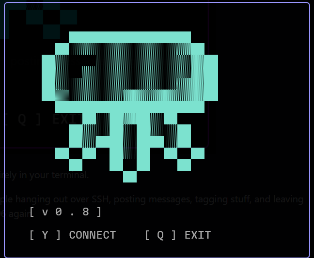
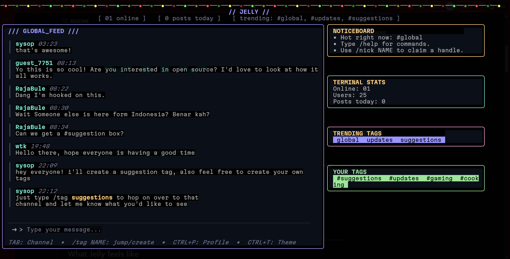
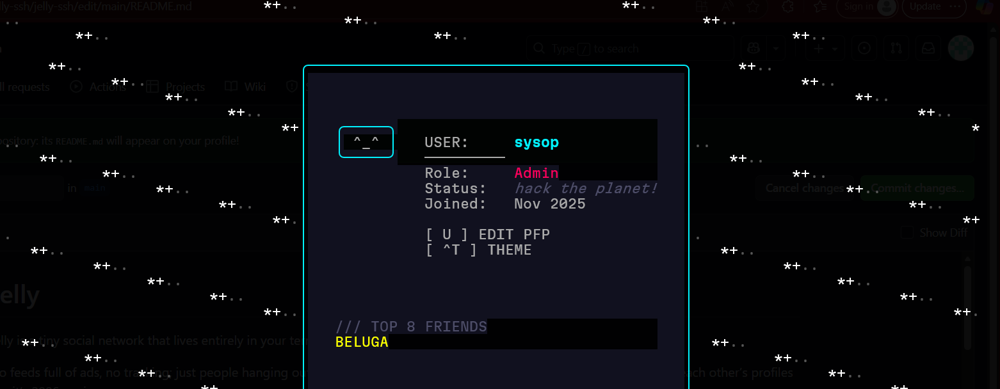

# Jelly



Jelly is a social network that only lives in your terminal.

No feeds full of ads, no tracking, or god awful algorithms pushing asinine content; just people hanging out over SSH, posting messages, creating channels, and leaving notes on each other's profiles.

Check out Jelly:
* How to connect
* FAQ / status
* Screenshots & updates

---




---

## How to connect

"if you discover it, you can join." If you can get into an SSH server, you're in.

### 1️⃣ Generate an SSH key (if you don't already have one)

Linux / macOS:

```bash
ssh-keygen -t ed25519 -C "jelly"
```

Windows (PowerShell):

```powershell
ssh-keygen -t ed25519 -C "jelly"
```

Accept the defaults and **don't lose your key**. Jelly uses it as your identity.

### 2️⃣ Connect to Jelly

```bash
ssh jellyshell.dev
```

* **Auth:** SSH public key only. No passwords, no web signup form
* Your identity is mapped from your SSH **public key fingerprint**
* First join: you get a guest-style username (e.g. `guest_1234`), which you can rename with `/nick`

If your terminal supports decent UTF‑8 and 256‑color/truecolor, you should be fine. (If something looks wrong, try another terminal and let me know in `#suggestions`.)

### Using Jelly on multiple devices

If you want to log in from a second machine without copying your SSH key around, just run `/addkey` on your main device. It gives you a short code to run on the other machine and that's it, both keys link to the same account.

---

## What you can do inside Jelly

### Global feed & home feed

* Post messages into a live-updating global timeline
* Scroll back through recent posts
* Switch to a **home feed** that only shows channels you've joined. `Ctrl+X` toggles between the two

### #Hashtag "channels"

* Use tags to directly go to channels like `#tui`, `#feedback`, `#gaming`, etc.
* Switch views with commands you can find in `/help`

### Direct messages

* `/msg NAME` to open a DM with someone
* DMs are encrypted at rest (AES-GCM)
* Unread indicators show up in your sidebar so you don't miss anything

### Notifications

* You get notified when someone DMs you, mentions you, signs your guestbook, or adds you to their Top 8
* Press `N` to open the notifications panel
* If your terminal supports desktop popups (WezTerm, Kitty, etc.), toggle them on with `Y` in the notifications panel and you'll get OS-level notifications
* You can also set a webhook with `/webhook URL` to pipe notifications to ntfy.sh, Discord, Slack, etc.

###  Profiles



* Every profile has a guestbook
* `/sign message` on someone's profile to leave a note
* Recent signatures show up on their page

* `/status text` set a short status line under your name
* Profile themes with different animated backgrounds
* Bio to let people know about yourself

### ASCII avatars

* Edit your avatar in a built-in ASCII editor
* Small size + printable characters only so it renders correctly in lots of terminals

### Top 8

* `/top8 NAME` — add someone to your Top 8
* `/rmtop8 NAME` — remove them
* Shows on your profile 

### Blackboard

* `/blackboard` a shared ASCII canvas everyone can draw on together

### Handy commands

From the main feed:

```text
/help              show commands
/global            jump back to global feed
Ctrl+X             toggle between global and home feed
/view NAME         open another user's profile
/msg NAME          open a DM
/top8 NAME         add to Top 8
/rmtop8 NAME       remove from Top 8
/webhook URL       set a webhook for notifications
/addkey            link a new device to your account
/block NAME        hide a user's posts
/quit, /exit       leave Jelly
Ctrl+C             also leaves Jelly (classic)
```

On profiles:

```text
/sign message      sign someone's guestbook
Ctrl+U             edit your PFP (when viewing your own profile)
Esc                back to feed
```

---

## Tech stack (for the curious)

How Jelly was built:

* **Language:** Go
* **Terminal UI:** [Bubble Tea](https://github.com/charmbracelet/bubbletea) + [Lip Gloss](https://github.com/charmbracelet/lipgloss)
* **SSH server:** [Wish](https://github.com/charmbracelet/wish)
* **Auth:** SSH public keys only
* **DMs:** At rest encryption
* **Rate limiting:** per-IP sliding window
* **Zero-downtime deploys:** tableflip so existing sessions stay connected when the server updates

---

## Status & roadmap

### Current status

* ✅ Public SSH server
* ✅ People actively hanging out and testing
* ✅ DMs, notifications, webhooks, multi-device keys
* 🚧 Features & UX still changing

### Rough roadmap

No promises, but things I'd *like* to explore:

* Better help / onboarding flow for new users
* Soft moderation tools (mutes / filters)
* Optional per-user notes / "mini blogs" on profiles
* Exportable data / backups
* End-to-end Encryption for DMs

---

## Feedback & bugs

If you've tried Jelly and something broke (or was just weird), you can:

* Open an **issue** on this repo
* Or hop into Jelly and drop a note in `#suggestions`

Screenshots, terminal info (kitty, iTerm2, Windows Terminal, WezTerm, etc.), and OS details really help when debugging rendering issues.

---

## Support

Right now Jelly is just one person paying for a small box on the internet because it makes me happy.

If you want to support it:

* Show up and hang out
* Tell other terminal-obsessed friends
* Star this repo if you like it

I may add a donation link (Ko‑fi / Buy Me a Coffee / etc.) here later once things settle down.

---

## Credits

Jelly is built and hosted by a single human who likes:

* terminals
* and the idea that not everything online has to feel like a growth-hacked product

If that speaks to you, you're exactly who I built this for.

If you made it this far, you probably already know how to find the server.


